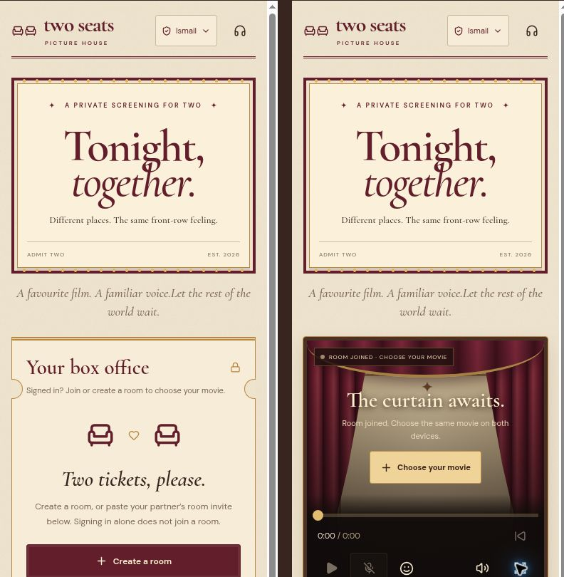

# Two Seats

Private movie nights, together. Built for two people watching from different places.

**Live website:** https://two-seats-movie-night.ismailmushraf.chatgpt.site

This repository contains the application source. Production runs on Sites with Cloudflare Workers and D1; pushing to GitHub does not redeploy the live website. Runtime TURN secrets and production data are not included.

A two-person, signed-in movie room. Each device selects its own copy of the movie; video bytes and local filenames are never uploaded. The server stores a sampled media fingerprint, file size, duration, playback state and short-lived WebRTC signaling/reactions.

## Run and validate

Use the Sites development helpers. Generate D1 migrations with `npm run db:generate`; apply them to the local preview as documented in the starter. `node tests/room.test.mjs` exercises the actual API against an isolated SQLite D1 adapter. `npx tsc --noEmit` checks types. Build using the Sites build helper.

## Access and privacy

Deployment starts owner-private. Grant the intended second person site access through Sites before sharing the room invite. Each participant signs in with ChatGPT. The hosting gateway injects authenticated identity; the API requires that identity and checks membership on every room operation. Do not put this Worker behind a gateway that accepts untrusted authenticated-user headers.

Invite secrets are 256-bit random bearer capabilities carried in URL fragments and stored hashed in D1. A guest seat is claimed atomically and bound to a signed-in account; a third account is rejected. Requests use same-origin JSON POST and explicit Origin validation. Rooms expire in 12 hours, and records are removed lazily on new room creation. Reactions and connection messages are bounded and rate limited. Expired rooms cannot be accessed even before cleanup. Closing a room removes its events immediately.

Only three rooms may be active per creator. Close the current room before creating another if not needed. An invite alone does not bypass private Site access. Device-local remembered movies, external subtitles and preferences are restored after refresh where storage or saved-file permissions allow. A refreshed page pauses the room and requires a fresh Ready tap; restoring the identical media fingerprint preserves the shared timeline.

## Playback and device limits

The server timestamps play/pause/seek commands and uses optimistic revision checks. Clients poll approximately every 850ms. Explicit play/pause/seek revisions apply once; ordinary drift uses gentle speed corrections. Large drift must persist before a recovery seek, with a cooldown. Seek sliders commit on release. Transient seek-related waiting does not pause the pair; sustained stalls report the actual stopped position. This is near-synchronized viewing, not frame-accurate playback. Buffering pauses both players and requires explicit resume. App-background pausing is best effort; keep both apps foregrounded. H.264/AAC MP4 is the recommended media format. Matching uses movie runtimes within two seconds; filenames, size and encoding may differ. Equal runtimes do not prove equal content or edits. Sampled fingerprints still identify a device’s saved copy for restoration.

On iPhone use Add to Home Screen and rotate to landscape. The expand control keeps inline video and custom controls in a full-viewport page. It does not request the native iOS video fullscreen presentation.

## Voice

WebRTC provides encrypted peer voice; microphones start muted. A click toggles transmission on/off. Backgrounding the page or disconnecting voice mutes the mic again. Headphones are recommended. STUN servers from Google and Cloudflare assist direct peer discovery and see network metadata. Voice messages carry both participants’ current attempt IDs; stale offers, candidates and disconnects cannot affect a newer attempt. TURN is optional at runtime but necessary for connectivity on restrictive networks. Set TURN_KEY_ID and TURN_KEY_API_TOKEN as Sites runtime secrets from a Cloudflare Realtime TURN key, then redeploy. The member-only, same-origin voice-config action generates four-hour ephemeral credentials server-side, at most four attempts per member per minute. Provider API keys never enter client code, responses or source. Without these runtime secrets, the UI explicitly reports direct-only voice and relay setup remains incomplete. Real-device voice connectivity remains unverified. Movie playback and reactions do not depend on voice connectivity.

## Verification status

API integration tests cover missing identity, cross-origin writes, invalid invites, outsider reads/writes, third participant rejection, guest close rejection, readiness, media mismatches, playback revisions, buffering pause, reactions, room limits, expiry and cleanup. Browser preview checks cover initial rendering, help and unsigned-in API feedback. Two physical iPhones, real media selection, mic permissions, voice connectivity and Home Screen landscape behavior still need device acceptance testing. Do not describe those checks as complete.

## Live delivery and microphone diagnostics

`/api/live` is a member-authorized SSE stream, renewed every 55 seconds. It reads room changes/events every 250ms and pushes changes to the browser; ordinary polling remains a recovery path. Voice-enabled peers also exchange reactions over an unordered RTC data channel. Reaction UUIDs prevent duplicates across transports and preserve simultaneous taps. Voice signaling runs in a separate asynchronous queue, so a stalled handshake cannot block reaction rendering. No zero-latency guarantee is made; the interface shows measured data-channel round-trip time when available.

Room state versions order membership, readiness, voice attempts, and playback snapshots independently of playback revisions. Stale HTTP snapshots cannot replace a newer voice attempt.

Microphone capture is requested directly from the user's tap before fetching relay credentials. Permission denial, missing devices, busy hardware, insecure contexts and iframe Permissions Policy blocks have distinct guidance. OS/browser permissions cannot be granted by the website. An Open in browser link preserves the non-secret room ID for existing members. Remote-audio autoplay denial has its own explicit audio-enable button. Waiting for a partner does not start a call-failure timer. Relay credentials are cached on both client and Worker to avoid unnecessary provider calls and rate-limit failures. Non-sensitive diagnostic codes are logged for support; SDP, device names and credentials are not logged.

## Local MKV / movie-audio compatibility

MKV is opened through a lazy-loaded, same-origin WebAssembly worker (libav-wasm 0.8.12). AC-3, E-AC-3, DTS, TrueHD and other decodable audio tracks are converted incrementally to AAC; AAC is passed through. Video is remuxed, not re-encoded, and the same HTMLVideoElement remains the timeline and immediate-pause target. `File.slice()` reads the source in bounded chunks; a short sliding MediaSource buffer avoids loading an entire multi-GB film into memory. Audio track changes serialize with decoding and pause shared playback first. Original-file identity is retained when repairing an already-loaded movie.

Movies first use compatibility mode so embedded text subtitles can be detected, including in MP4. Non-Matroska files that cannot use this mode fall back to native playback. Repair sound / load subtitles retries compatibility mode for a selection. Browsers with ManagedMediaSource (including recent iPhone Safari) use it with remote playback disabled. Older browsers without either media-source API receive an explicit conversion instruction. Unsupported video, DRM, damaged files, device memory/CPU limits and missing decoders remain limits; universal format support is not claimed. Codec assets are regenerated from the pinned package on dev/build and served from this site's origin. CSP allows WebAssembly compilation without general unsafe-eval or third-party worker/script origins. See `/media-codecs-notices.txt` for upstream sources.

Reproduce codec QA using `node tests/prepare-media-qa.mjs`, managed preview `/media-qa`, and its Run codec checks button. Repeat with `?fallback=1` to exercise the Asyncify (non-JSPI) decoder. The harness generates synthetic H.264 MKVs with AC-3, E-AC-3, DTS, TrueHD and two audio tracks. It checks actual decoded PCM energy via Web Audio, advancement, immediate pause, seeks/resume, track switching, movie ending/replay and cancellation. Run `node tests/prepare-media-qa.mjs --clean` before production builds; QA routes/fixtures are not published. Chrome passed real codec playback checks in both decoder modes. This is not a physical iPhone or the user's exact movie acceptance test.

## Voice toggles, speech ducking and subtitles

Both mic buttons use ordinary accessible click toggles sharing one microphone state; releasing a pointer or focusing another control does not mute. The mic stays muted until tapped, and backgrounding, rebuilding a connection, a lost connection or stopping voice resets it. The emoji popup remains open after sending and toggles only with its smiley button.

An AudioContext routes movie audio through a gain node once voice is enabled. Local and incoming voice streams are metered locally every 50ms, never routed back to the speakers. Speech lowers movie gain to 0.25; 550ms of silence plus a smooth release restores it. Gain leaves the movie's mute flag and the separate partner-audio element intact. Context resume happens on user gestures; no movie is rerouted into a context until it is running.

Embedded SRT, ASS/SSA and MP4 mov_text are converted to safe plain timed text, with first text track shown automatically, a track/Off selector, and a CC toggle in the video controls. Text formatting/drawing tags are stripped; VobSub/DVB image subtitles, karaoke effects and original ASS layout/fonts are not rendered. Cues use the video clock and persist/deduplicate across seeks, with a short demux preroll to recover captions beginning before the target keyframe. Changing the movie clears its subtitle data. Track selection is local to each viewer.

Additional QA: `node tests/prepare-media-qa.mjs --features`, then Run feature checks at `/media-qa` and `/media-qa?mp4=1`. It uses synthetic voice streams to measure actual movie output lowering/restoration, and embedded SRT/ASS/mov_text fixtures to verify captions, Off, switching and seeks. Run cleanup before publishing. `node tests/voice-controls.test.mjs` verifies speech thresholds/hold/reset and subtitle packet handling. Physical phone permissions, two-person voice and device-specific audio routing still require user acceptance testing.

## Subtitle rendering compatibility repair

Subtitles now render through `SubtitleOverlay` inside the same stage as the inline video and custom expanded fullscreen. They no longer rely on HTML track/VTTCue painting or a browser-controlled cue position. The renderer reads the actual video time every 80ms and on seek/time/metadata events, uses plain React text, preserves line breaks, and remains above the video and above its controls. The indexed timeline supports overlaps, paused seeks and deduplication without rescanning a whole feature film each frame.

The panel reports decoded line counts, detects the absence of text tracks, and offers local SRT/VTT/ASS/SSA files (5 MB max; UTF-8 or BOM-marked UTF-16). An external file overrides the selected embedded track on this device. Offset seconds are also local: positive values delay subtitles. Movie bytes, subtitle contents and filenames are never sent to the room service. PGS picture subtitles now have a local graphics decoder; other unsupported image formats still require a text subtitle file. The user's exact movie is not available to the agent, so its codec cannot be diagnosed from synthetic fixtures.

`node tests/subtitles.test.mjs` covers rendering data with no native text-track APIs, numeric-string stream IDs, byte payloads, multilingual captions, sidecar formats, overlaps, Off, deduplication and cleanup. Feature browser QA additionally asserts that real embedded MKV and MP4 captions are present in the actual rendered subtitle overlay.

## Subtitle extraction and session recovery

Subtitle packets with missing/zero durations are no longer discarded. An estimate (up to eight seconds, clipped at the next subtitle start) is replaced by exact timing if it becomes available. The app also reads supported text subtitle blocks directly from local MKV clusters in a short window around playback, independently of libav's video-remuxer subtitle output. It handles Matroska zlib and header-stripping compression, indexes/skips media ranges, and cancels on movie changes. It decodes PGS bitmap subtitles through the local graphics pipeline; VobSub/DVB are not decoded; actual MKV codec IDs and packet diagnostics are visible instead of an indefinite generic waiting message. Text tracks are preferred over picture tracks when both are available.

Room expiry is twelve hours and is independent of the hosting gateway's login cookie. API responses are checked for status/content type before JSON parsing. HTML login gates, JSON/HTML 401s, incomplete JSON and HTML server failures have separate handling. After a previously verified session fails a check, media/microphone and writes stop locally, the room/file selection are retained, and verification retries for ten seconds. A transient failure recovers without logout. Only repeated authentication failures trigger the Sign in prompt; network failures remain retryable connection errors. Sign in returns to the existing non-secret member room URL. Auth epochs prevent stale checks, HTTP responses or SSE snapshots from restarting playback after verification is lost. Recovered playback requires an explicit Play tap. The app cannot extend or configure the provider's session cookie.

Regression checks: `tests/api-response.test.mjs`, `tests/matroska-subtitles.test.mjs`, and prior subtitle/playback/security tests. Prepare browser session simulations with `node tests/prepare-media-qa.mjs --auth`; it renders the real Cinema component against local fake responses and is removed by normal QA cleanup. Test both one HTML response (automatic recovery) and persistent HTML login responses (confirmed sign-in prompt and room return URL). No test route or mock authentication is included in production.

## Embedded PGS picture subtitles

S_HDMV/PGS is now decoded from original Matroska packet bytes, not from the text-only libav API. `pgs.ts` implements palette colour/alpha conversion (BT.601/709), RLE, multi-packet object assembly, epoch/acquisition resets, composition/window placement, cropping, palette updates and clear displays. Matroska timestamps/durations control presentation; absent durations last until the next presentation/clear event. The picture is painted to a pointer-transparent canvas in the existing stage using the actual video clock, so custom expanded viewing keeps subtitles, mic and reactions together. Scaling handles video letterboxing and keeps the bottom subtitle pictures clear of the controls. No OCR, subtitle search, file upload or external service is used.

Only the selected PGS track is decoded. Compressed object/frame caches and raster allocations have size/count limits. Decoded seek coverage prevents an old picture remaining visible while another part of the file is read; seeks use a 60-second graphics preroll. Switching tracks or movies releases graphics caches. PGS outside the decoded preroll may wait for a complete palette/object acquisition set; malformed/encrypted streams and VobSub/DVB remain outside this implementation. No physical-device or exact-user-movie pass is claimed.

Tests: `node tests/pgs.test.mjs` covers pixel/alpha output, clear times, split objects, palettes, multi-object compositions, cropping, long RLE runs, malformed-input bounds and seek coverage. `node tests/prepare-media-qa.mjs --pgs` generates original synthetic PGS pictures in a SUP stream, uses FFmpeg to mux them into a real MKV, and prepares `/media-qa`. The browser harness verifies actual canvas pixels, pause, clearing, palette changes, seeking and CC Off/On. PGS fixtures were also successfully decoded by FFmpeg's independent subtitle decoder for comparison. The expanded preview was visually inspected with the picture subtitle visible. Remove all generated QA files before production builds.

## Long-session playback and voice recovery

Media compatibility now evicts old SourceBuffer frames before appending. A synchronous browser `QuotaExceededError` triggers one tighter history trim and retries the exact same fragment. Decode failures still pause shared playback and show the error; there is no unbounded retry or silent timeline reset. The decoder, media matching and explicit pause/seek controls retain their existing behavior.

A failed background session probe caused by a network outage or gateway 5xx preserves the previously verified session and retries after five seconds. Explicit sign-in failures still quarantine playback, microphone and writes and retain the existing expiry confirmation flow. Room APIs continue to enforce authentication independently.

Each voice peer now has a bounded ICE recovery loop: brief disconnects get five seconds to recover naturally, then up to three restart attempts at twelve-second intervals. Either participant can request recovery through member- and voice-session-checked signaling; only the room owner creates restart offers to avoid negotiation collisions. Expired relay configuration is refreshed as needed. Recovery never acquires a new microphone or unmutes it. User disconnect, peer replacement and unmount cancel recovery. Late ICE candidates from an older generation no longer fail the whole handshake.

`node tests/long-session.test.mjs` exercises three simulated hours of buffer maintenance including quota pressure at minute 35, bounded quota failures, recovery timing and cancellation. `node tests/prepare-media-qa.mjs --long` prepares a synthetic 40-minute H.264/AC-3 MKV and a browser harness that processes every fragment sequentially, checks bounded buffering, then exercises playback/pause past minute 39 and seeking back to minute 35. This accelerates media processing and buffered seeking; it is not a forty-minute wall-clock or physical-phone test. `--connection` prepares the actual Cinema component with simulated microphone/RTC/API responses to check a failed background probe, network interruption and explicit login expiry. Clean generated fixtures/routes before publishing. Production logs did not identify the user's original failure, and the exact movie and two-device network conditions still need user verification.

## Vintage picture-house interface

The interface uses a cream marquee, burgundy velvet curtains, brass accents and a ticket-style room panel. Mobile layouts show room setup first in the lobby and prioritize the player after joining. Player buttons use a two-row arrangement on narrow phones, including rewind, mic, reactions, captions, volume and expand. Text subtitle placement and bitmap subtitle clearance account for the taller controls. Large-screen and expanded landscape layouts retain a single control row.

Browser checks covered 320px and 390px layouts, a 1200px desktop layout, reaction-picker persistence and expanded viewing. At the narrowest tested layout all player buttons measured at least 44px in each dimension with no page overflow. All forty existing named application functions were compared with the prior source and remained unchanged. Playback, voice and recovery regressions and TypeScript checks passed. Temporary mock-auth preview routes are excluded from production.

## Voice call invitations

Enable voice sends your partner an in-room Accept / Decline dialog, including in the expanded player. Microphone capture starts only from that person's own tap; accepted calls start muted. Calling from both devices together counts as mutual consent and the owner makes a single WebRTC offer. The caller can cancel, and an unanswered invitation times out after 60 seconds while the tab is active. Invitations require both people to have the room open.

Acceptance and decline target a specific call session. Atomic server guards reject expired or already accepted invitations; cancellation tombstones prevent delayed requests from reviving canceled calls. Retry, microphone permission, speech ducking and ICE recovery continue through the existing voice connection.

Validation: `node tests/room.test.mjs` covers invitation consent and races. `node tests/prepare-media-qa.mjs --calls` provides two real player UIs with synthetic microphones and shared simulated signaling; remove the generated route with `--clean` before building. This fixture checks UI behavior, not real cross-network audio delivery.

## Interrupted requests and Ready recovery

Readiness is posted independently of the best-effort video autoplay priming. Sync-driven pauses can reject `play()` with AbortError; that expected interruption no longer blocks Ready. A genuine autoplay permission restriction still offers the playback unlock control.

Room polling and live streams stop when hidden and reopen with a fresh snapshot/cursor on visibility, pageshow or network recovery. Obsolete polls are canceled silently. Safe reads, Ready, voice configuration and session-scoped voice changes get one bounded retry after a connection interruption; playback commands and room creation are not blindly replayed. Unresolved connection failures use a readable retry message rather than raw browser abort text.

Voice negotiation waits until the local call session appears in the room snapshot. An incoming offer/candidate arriving ahead of its matching snapshot is kept briefly in a bounded inbox and processed once the snapshot catches up. This avoids negotiating an unadvertised attempt or permanently discarding early signaling. Existing membership checks, mic consent and stale-session rejection remain in place.

`node tests/connection-interruption.test.mjs` covers interrupted priming, stale own-session snapshots, early signaling, retry limits, explicit cancellation, timeouts and auth failures. Call browser QA supports `?real=1` for native WebRTC with synthetic silent audio; same-browser signaling succeeds, but the cloud browser produced no ICE candidates without a relay, so actual cross-network audio remains a device acceptance test.

## Paired playback stability

The player now monitors actual clock progress while the room is playing. Four seconds without progress, a stuck seek, an unexpected pause, or an autoplay block pauses locally and reports the stalled position to the room. Normal buffering also keeps its shorter waiting check. A visible status explains the shared pause; Play starts a fresh attempt. Reports are scoped to the observed playback revision so an old report cannot cancel a newer Play or Seek. If the room service is temporarily unreachable, the local hold remains and retries are serialized every five seconds. Network failure can still delay the partner receiving a pause.

A pending media `play()` promise no longer delays sending a shared control or creates another play promise on every poll. Existing immediate pause and seek-intent rules remain in place. Automatic drift recovery waits for decodable data instead of repeatedly seeking a starved player toward a moving target.

Compatibility startup fills approximately three seconds (or the available short/end fragment) before exposing the loaded movie. Subtitle scans start once playable data is buffered, yield between clusters/packet batches, and remain independent of audio/video decoding failures. Subtitle parsing/rendering errors no longer tear down the movie decoder. Unexpected MediaSource closure now produces a visible repair message and shared pause.

`tests/playback-health.test.mjs` covers frozen clocks, seeks, unexpected pauses, loading/background exemptions, grace periods and play-promise deduplication. Room integration tests reject stale buffering revisions. `node tests/prepare-media-qa.mjs --stability` renders two actual Cinema players against shared simulated room signaling, with real local MKV audio conversion and subtitles, plus synthetic voice. It can freeze one player's play promise to verify the production detector pauses both, then release it for resume and seeking. This is a browser regression fixture, not a test of the user's exact movie or physical phone. Remove generated routes/assets before publishing.

Browser results for this revision: two actual Cinema components played synthetic H.264/AC-3 MKVs with SRT/ASS captions; the synthetic voice connection stayed enabled. Deliberately freezing one play promise produced one shared buffering pause, with both clocks settling around 8.001 seconds. Release, resume, seeking back to the first caption and completion passed. The separate real-MKV PGS fixture passed all eleven rendering, seek, palette, clear, crop and track-toggle checks. The user's exact movie and physical-device behavior remain unverified.

## Remembered movies, runtime matching and owner diagnostics

Remember movie is enabled by default and scoped to the signed-in account in this browser. On browsers supporting `showOpenFilePicker`, an IndexedDB-stored read-only file handle avoids duplicating the movie. Refresh queries its permission silently; if permission is no longer granted, Restore movie requests it from a tap. Other browsers use an IndexedDB Blob copy when quota permits. No arbitrary local path is opened, and there is no movie upload. Copying can take time for large films; the status reports completion, quota failures or unavailable storage. Browser eviction, private browsing, moved files or revoked permission can still require a new selection. Forget saved files disables remembering and removes that account’s movie and subtitle preferences while keeping the currently open movie.

External subtitle contents (up to the existing 5 MB limit), chosen subtitle track, timing offset and chosen audio track are stored separately against the local media fingerprint. Refresh restores these settings after decoding the movie. The page attaches to the room with a shared pause and fresh Ready/mic consent; it does not silently resume playback or reopen the microphone. Restoring an unchanged movie does not reset the shared timeline to zero. Runtime matching allows different encodes within two seconds, with an explicit same-edit warning.

`/diagnostics` reads reports only for the verified Site owner email configured by runtime secret `DIAGNOSTICS_OWNER_EMAIL`; missing configuration denies everyone. Both room members may submit bounded, sanitized reports for their own device. The owner can view/export both devices’ logs. The endpoint enforces authentication, membership, same-origin JSON writes, report count/rate limits and a strict field/code allowlist. Movie names/paths/bytes, subtitle text, audio, SDP, candidate IP addresses and credentials are excluded. The D1 diagnostics table intentionally survives room deletion; reports expire from reads after 14 days, with lazy cleanup and a maximum 5,000 rows on insert. Delayed device reports can be sent while the historical room membership still exists.

While a room is open, checks verify movie-clock advancement, report dropped-frame spikes, buffering, decoder/subtitle failures, browser visibility/network changes and WebRTC/ICE state. Call stats include coarse candidate type, RTT, jitter and packet loss. Small sanitized queues are retained on the device during network outages and retried later. This detects problems; it cannot certify perfect playback, record the call or monitor a closed browser. Reports can reflect a suspended browser or local resource pressure without proving one exact root cause.

Voice recovery defers without consuming active attempts while offline/backgrounded or while the partner is away. A later attempt can force configured TURN relay candidates. Exhausted recovery releases the call and reports why; explicit hangups, browser refresh and microphone loss have distinct partner-facing messages. Diagnostics opens in a separate tab to preserve the player/call.

For assistant debugging, use Sites `read_database_overview` for this project, then read the returned exact `diagnostics` table through `read_database_table_rows`. This is owner-authorized access through Sites; it does not rely on a public debugging token or relaxed viewer permissions. Inspect reports only when asked; no autonomous background repair is configured.

Validation: `tests/diagnostics.test.mjs`, `tests/local-movie.test.mjs`, room refresh/runtime integration tests and the extended voice recovery tests. The paired browser fixture verified different MKV/MP4 encodes, local movie restoration after a page reload, restored external SRT plus a 2.5-second offset, readable health reports for the owner and denied access for the partner. Physical iPhone storage permissions, very large-file caching and real cross-network calls remain device acceptance checks.
